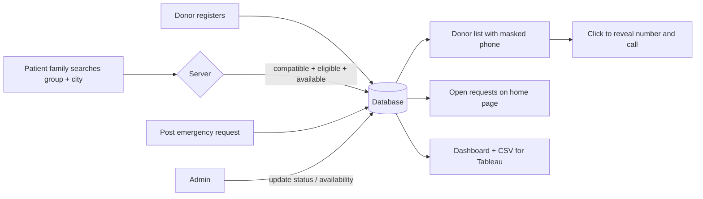

# LifeLink – Blood Donor Finder

**TPDS-III Project | 5th Semester CSD**

| | |
|---|---|
| Team members | _Name (Roll No.)_, _Name (Roll No.)_, _Name (Roll No.)_ |
| Subject | TPDS-III |
| Guide | _Guide name_ |

---

## 1. Problem Statement

When a patient needs blood urgently, the family usually posts on WhatsApp groups, calls relatives and runs between blood banks. This wastes hours. There is no simple place to see:

- who has the required (or a compatible) blood group,
- who is in the same city,
- who is actually **eligible** to donate today (a donor must wait about 90 days between whole-blood donations).

Rh-negative groups (**O-, A-, B-, AB-**) together make up only around 5% of people in India, so finding them in time is even harder.

**Intended users**
- **Patients' families / hospital staff:** search donors and post emergency requests.
- **Donors:** students and the public who register to help.
- **Admin:** the college NSS/NCC unit or a blood bank coordinator, who manages donors and closes requests.

**Why it matters:** in an emergency, finding the right donor quickly can save a life.

---

## 2. Objectives and Scope

**Objectives**
1. Let donors register with their blood group, city and last donation date.
2. Let anyone search for donors who are **compatible**, **eligible** (90+ days since their last donation) and **available**, in a chosen city, in under 1 second.
3. Let people post emergency requests that everyone can see on the home page.
4. Protect donor privacy: phone numbers stay hidden until someone clicks to reveal them.
5. Give the admin a dashboard to see shortages by blood group and city.
6. Deploy the app with Docker on a cloud platform, with the code managed in Git.

**Expected outcome:** a working website where a search returns the right donors instantly, plus a dashboard that shows where and which blood groups are in short supply.

**Scope (what is included)**
- 12 major Indian cities, 8 blood groups, red-cell compatibility rules, a 90-day eligibility rule.
- One admin login protected by a key.

**Not included (boundaries)**
- No SMS/OTP verification of donors.
- No live GPS tracking.
- No individual login for each donor.
- No integration with hospital or blood bank stock systems.

---

## 3. Existing Solutions and Our Improvement

| Existing approach | Limitation | What LifeLink does |
|---|---|---|
| WhatsApp / social media posts | Messages get lost, there is no filtering, and old posts get forwarded again and again | A structured search by group and city, plus a live list of open requests |
| Phone calls to blood banks | Only stock information, slow, depends on office hours | Direct contact with willing donors, 24x7 |
| e-RaktKosh / big national apps | Mostly blood-bank stock; can be heavy for small campus or community use | A lightweight portal focused on individual donors, deployable by a college or NGO |
| Simple donor lists in Excel | No eligibility check, phone numbers exposed to everyone | Automatic 90-day check, compatibility logic and masked phone numbers |

---

## 4. Proposed System

### 4.1 Architecture

```
  Browser (Bootstrap UI)                       Tableau / Power BI
  ├─ Find Donor  ├─ Register  ├─ Request             ▲
  ├─ Admin       └─ Dashboard (Chart.js + Leaflet)   │ CSV export
          │                                           │
          │  HTTP requests (JSON / REST)              │
          ▼                                           │
  ┌──────────── Node.js + Express server ───────────────┐
  │  Validation  →  Compatibility + eligibility logic   │
  │  Admin key check  →  Error handling                 │
  └───────────────────────┬─────────────────────────────┘
                          │ SQL queries
                          ▼
                 SQLite database (donors, requests)

  Code on GitHub  →  Docker image  →  Deployed on Render (cloud)
```

### 4.2 Workflow



### 4.3 Data Design

**donors**: `id, name, phone (unique), email, age (18–65), gender, blood_group, city, area, last_donation, available, created_at`

**requests**: `id, patient_name, blood_group, units (1–10), hospital, city, contact, urgency (Normal/Urgent/Critical), status (Open/Fulfilled/Cancelled), created_at, closed_at`

The database enforces these rules itself with `CHECK` constraints. An index on `(city, blood_group)` keeps searches fast.

### 4.4 Blood Compatibility Used (red cells)

| Patient | Can receive from |
|---|---|
| O- | O- |
| O+ | O+, O- |
| A- | A-, O- |
| A+ | A+, A-, O+, O- |
| B- | B-, O- |
| B+ | B+, B-, O+, O- |
| AB- | AB-, A-, B-, O- |
| AB+ | All groups |

---

## 5. Four-Module Mapping Table

| Module | Concept applied | Where it is in the project |
|---|---|---|
| **M1: Dashboard designing** | Open-source dashboard and chart creation | `dashboard.html` / `js/dashboard.js`: KPI cards, a stacked bar chart, a grouped bar chart (supply vs demand) and a doughnut chart, built with **Chart.js** |
| | Data connection | The dashboard reads live data from the `/api/stats` REST endpoint |
| | Mapping data | A **Leaflet + OpenStreetMap** map with circles sized by the number of donors in each city |
| | Tableau / Power BI | `/api/export/donors.csv` includes **latitude and longitude** columns for a Tableau map; `/api/export/requests.csv` holds the request data (section 9) |
| | Dashboard deployment | The dashboard is deployed with the app; the Tableau dashboard is published to Tableau Public |
| **M2: Front end** | Responsive design (Bootstrap 5) | Grid layout, a collapsible navbar on mobile, responsive tables, cards |
| | UI controls and dialogs | Validated forms, select boxes, a date picker, switches, tabs (pills), a **modal** to reveal contacts, a **delete confirmation modal**, a **toast** notification, badges |
| | Design patterns | A shared `common.js` (API helper, escaping, dropdown filling), one reusable form handler for two forms, a consistent layout on every page |
| **M3: Back end** | Web server and HTTP | Express server; `GET`, `POST`, `PATCH`, `DELETE`; status codes 200/201/204/400/401/403/404/409/500 |
| | SQL database | SQLite: two tables, `CHECK` and `UNIQUE` constraints, an index, `GROUP BY`, `SUM`, `AVG`, `CASE`, date functions (`julianday`) for eligibility, parameterised queries |
| | NodeJS + ExpressJS | `app.js` (routes, validation, admin middleware, error handler), `db.js`, `seed.js` |
| **M4: Git and deployment** | Git version control | GitHub repository, commits, branches, push/pull (section 8) |
| | Dockerization | `Dockerfile` and `docker-compose.yml` with a persistent volume |
| | Cloud deployment | Deployed on Render (free) using the Dockerfile; also works on Railway or AWS EC2 |

---

## 6. Implementation

### 6.1 Tools and Technologies

| Layer | Technology |
|---|---|
| Front end | HTML5, CSS3, JavaScript, Bootstrap 5.3, Bootstrap Icons |
| Charts and map | Chart.js 4, Leaflet 1.9 + OpenStreetMap |
| Back end | Node.js 20, Express 4 |
| Database | SQLite (better-sqlite3) |
| Testing | Node test runner + Supertest |
| BI tools | Tableau Public / Power BI Desktop |
| DevOps | Git, GitHub, Docker, Render |

### 6.2 Project Structure

```
lifelink/
├── app.js              Express routes, validation, business logic
├── server.js           Starts the server
├── db.js               Database connection and table creation
├── data.js             Blood groups, compatibility table, city coordinates
├── seed.js             Loads sample data (300 donors, 60 requests)
├── public/
│   ├── index.html      Find donor + open requests
│   ├── register.html   Donor registration
│   ├── request.html    Emergency request form
│   ├── admin.html      Admin panel
│   ├── dashboard.html  Analytics dashboard + map
│   ├── style.css
│   └── js/             common.js, search.js, forms.js, admin.js, dashboard.js
├── tests/api.test.js   21 automated test cases
├── Dockerfile
├── docker-compose.yml
└── package.json
```

### 6.3 API Endpoints

| Method | Endpoint | Purpose | Access |
|---|---|---|---|
| GET | `/api/meta` | Blood groups, cities, compatibility | Public |
| POST | `/api/donors` | Register a donor | Public |
| GET | `/api/donors/search?blood_group=&city=` | Find compatible, eligible donors | Public |
| GET | `/api/donors/:id/contact` | Reveal a donor's phone | Public |
| POST | `/api/requests` | Post an emergency request | Public |
| GET | `/api/requests` | List open requests (most urgent first) | Public |
| GET | `/api/stats` | Dashboard data | Public |
| GET | `/api/export/donors.csv`, `/api/export/requests.csv` | Data for Tableau / Power BI | Public |
| GET/PATCH/DELETE | `/api/admin/donors[/:id]` | Manage donors | Admin key |
| GET/PATCH | `/api/admin/requests[/:id]` | Close or cancel requests | Admin key |

---

## 7. How to Run (User Instructions)

**Requirements:** Node.js 18 or newer (or Docker).

```bash
npm install
npm run seed     # optional: loads 300 sample donors and 60 requests
npm start        # open http://localhost:3000
npm test         # runs all 21 test cases
```

| Page | URL | What to do |
|---|---|---|
| Find Donor | `/` | Choose the patient's blood group and city, then Search. Click the phone button to see the number. |
| Become a Donor | `/register.html` | Fill in the form and tick consent. |
| Request Blood | `/request.html` | Post a request; it tells you how many donors match. |
| Dashboard | `/dashboard.html` | Charts, a map and CSV downloads. |
| Admin | `/admin.html` | Key: `admin123`. Change request status, update a donor's last donation date or availability, delete a donor. |

To use your own admin key: `ADMIN_KEY=mysecret npm start`

**Error handling users will see**
- Red messages under each wrong form field (browser-side checks).
- Server-side messages such as *"Phone must be a valid 10 digit mobile number"* or *"This phone number is already registered"*.
- When no donor is found, the page suggests posting an emergency request instead.
- A wrong admin key shows *"Invalid admin key"*. A broken JSON request returns a 400 response instead of crashing the server.

### Run with Docker

```bash
docker compose up --build
# or
docker build -t lifelink .
docker run -p 3000:3000 -e ADMIN_KEY=admin123 lifelink
```

On the first start, the container loads sample data. The data is kept in the `lifelink-data` volume.

---

## 8. Git Workflow

```bash
git init
git add .
git commit -m "Initial version of LifeLink"
git branch -M main
git remote add origin https://github.com/<username>/lifelink.git
git push -u origin main

git checkout -b feature/dashboard-map
git add .
git commit -m "Add Leaflet map to dashboard"
git push origin feature/dashboard-map
# open a Pull Request on GitHub and merge it

git checkout main
git pull origin main
```

### Deploy on Render

1. Push the code to GitHub.
2. On render.com, choose **New → Web Service** and connect the repository.
3. Render detects the `Dockerfile`. Choose the **Docker** runtime.
4. Add the environment variable `ADMIN_KEY`.
5. Deploy. You get a public link like `https://lifelink.onrender.com`.

On the free plan, the disk is not permanent, so data resets on restart and the sample data loads again. For permanent data, use a Render disk mounted at `/app/data`, Railway, or `docker compose` on an AWS EC2 instance.

---

## 9. Tableau / Power BI Dashboard

1. Download `donors.csv` and `requests.csv` from the dashboard page.
2. **Tableau Public:** Connect → Text File → choose `donors.csv`.
3. Set `latitude` and `longitude` as geographic roles. Drag them onto the sheet to get a **map of India**. Use `COUNT(id)` for size and `blood_group` for colour.
4. Make these sheets:
   - Bar chart: `blood_group` vs `COUNT(id)`, filtered by `eligible = 1`
   - Pie chart: `available`
   - From `requests.csv`: `status` share, `units` by `blood_group`, requests per `city`
5. Combine the sheets in a **Dashboard**, add a `city` filter, and publish to Tableau Public to get a shareable link.
6. **Power BI:** Get Data → Text/CSV → use the *Map* visual with latitude and longitude → build the same charts → Publish.

---

## 10. Testing and Results

All tests run with `npm test` on an in-memory database, so real data is never touched.

| ID | Type | Test | Expected | Result |
|---|---|---|---|---|
| TC01 | Normal | Register a valid donor | 201 Created | Pass |
| TC02 | Normal | A+ patient search returns A+ and O- donors, exact match first | 2 donors, A+ first | Pass |
| TC03 | Normal | O- patient search returns only O- | No A+ in the result | Pass |
| TC04 | Normal | Phone is masked in search and revealed on click | `98XXXXXX01`, then the full number | Pass |
| TC05 | Normal | Post a request, get the matching donor count | 201, matches = 2 | Pass |
| TC06 | Normal | The open request appears in the list | 1 open | Pass |
| TC07 | Normal | Admin marks a request Fulfilled | `closed_at` is set, removed from the open list | Pass |
| TC08 | Normal | An unavailable donor is hidden | Not in search, contact returns 403 | Pass |
| TC09 | Normal | Stats and CSV export | Correct counts, CSV includes lat/long | Pass |
| TC10 | Wrong input | Empty form | 400 with a list of errors | Pass |
| TC11 | Wrong input | Phone `12345`, `5876543210`, 11 digits, letters | 400 | Pass |
| TC12 | Wrong input | Blood group `C+`, city `London` | 400 | Pass |
| TC13 | Wrong input | Duplicate phone number | 409 Conflict | Pass |
| TC14 | Wrong input | Last donation date in the future | 400 | Pass |
| TC15 | Wrong input | Admin API with no key or a wrong key | 401 | Pass |
| TC16 | Wrong input | Broken JSON, SQL injection in the query and the name | 400 / stored as text, table safe | Pass |
| TC17 | Boundary | Age 17 / 18 / 65 / 66 | 400 / 201 / 201 / 400 | Pass |
| TC18 | Boundary | Last donation 89 days ago vs 90 days ago | 89 hidden, 90 shown | Pass |
| TC19 | Boundary | Units 0 / 1 / 10 / 11 | 400 / 201 / 201 / 400 | Pass |
| TC20 | Boundary | City with no donors | 200 with an empty list | Pass |
| TC21 | Boundary | ID 0, a missing ID, an unknown route | 400 / 404 / 404 | Pass |

**Result: 21 of 21 test cases passed.**

### Results Against the Objectives

| Objective | Measured result | Achieved |
|---|---|---|
| Search in under 1 second | Over 200 searches on 300 donors: **average 2.1 ms**, 95th percentile 3.3 ms (local machine) | Yes |
| Only compatible donors shown | TC02, TC03 | Yes |
| Only eligible donors shown | TC18 (90-day boundary) | Yes |
| Privacy of phone numbers | TC04 (masked until clicked) | Yes |
| Wrong input never crashes the app | TC10–TC16 | Yes |
| Dashboard shows shortages | Supply-vs-demand chart and city map | Yes |
| Docker and cloud deployment | Dockerfile, compose file, Render steps | Yes |

---

## 11. Applications

- **Colleges:** the NSS/NCC unit keeps a donor list of students and staff and organises donation camps.
- **Hospitals:** staff quickly find donors for rare blood groups.
- **NGOs and blood donation groups:** replace WhatsApp lists with a searchable system.
- **Housing societies and companies:** an internal donor network for emergencies.
- **Planning:** the dashboard shows which groups and cities have shortages, so camps can target them.

---

## 12. Original Contribution

What we designed ourselves:
- **Combined search logic:** compatibility, the 90-day eligibility rule and availability are checked together in one SQL query, and exact matches are listed first.
- **Privacy by design:** the phone number is masked in search results and shown only when someone clicks to reveal it.
- **Smart request flow:** after posting a request, the user sees how many donors match and gets a direct link to them.
- **Supply-vs-demand chart:** eligible donors are compared with units requested for each blood group, which shows real shortages.
- **CSV export with coordinates:** the export is ready for a Tableau or Power BI map without extra cleaning.
- A database schema with constraints, and 21 automated tests covering normal, wrong-input and boundary cases.

---

## 13. Limitations

- Donors enter their own details; phone numbers are not verified with OTP.
- There is one shared admin key instead of separate admin accounts.
- Location works at the city level only (a fixed list of 12 cities), not by exact distance.
- SQLite suits a single server; a large public deployment would need PostgreSQL or MySQL.
- The 90-day gap is a general rule; actual eligibility also depends on health and on the donor's gender (often 90 days for men and 120 for women).

## 14. Future Scope

- OTP verification and a donor login, so donors can update their own details.
- SMS or WhatsApp alerts to matching donors when a request is posted.
- GPS-based nearest-donor search sorted by distance.
- Different donation gaps for men and women, and reminders when a donor becomes eligible again.
- Integration with blood bank stock (e-RaktKosh) and a mobile app version.

---

## 15. Conclusion

LifeLink turns a slow, manual search for blood donors into a quick online search. It returns only compatible, eligible and available donors, keeps their numbers private, and gives coordinators a dashboard of shortages. The project applies all four modules: dashboards (Chart.js, Leaflet, Tableau), a responsive Bootstrap front end, a Node/Express back end with SQL, and Git with Docker-based cloud deployment.

---

## 16. Individual Contributions

| Member | Roll No. | Contribution |
|---|---|---|
| | | |
| | | |
| | | |

---

## 17. Acknowledgements and References

- Bootstrap, Bootstrap Icons, Chart.js, Leaflet, Express, better-sqlite3: open-source libraries under the MIT/BSD licences.
- Map data © OpenStreetMap contributors.
- The sample data is synthetic, generated by `seed.js`. No real person's data is used.
- AI assistance was used during development; all code was reviewed and tested by the team.
- Blood compatibility and donation interval: National Blood Transfusion Council (NBTC), India – Guidelines for Blood Donor Selection.
- Express documentation: https://expressjs.com
- Chart.js documentation: https://www.chartjs.org/docs
- Leaflet documentation: https://leafletjs.com
- Docker documentation: https://docs.docker.com
- Render documentation: https://render.com/docs
